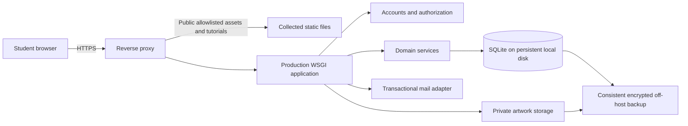

# Target architecture

> Account policy update: use username/password accounts with immediate login. Email collection, verification, SMTP/outbox delivery and emailed recovery in the original plan below are superseded by [AUTHENTICATION.md](AUTHENTICATION.md). Signed-in password changes require the current passphrase; forgotten passwords use a trusted local administrator reset.

## Decision

Use a Django modular monolith rather than building authentication primitives or splitting a small application into microservices. SQLite is required for the first single-host release. Preserve plain HTML/CSS/JavaScript and canvas. The exact supported Django/Python patch versions must be chosen and pinned during implementation; this document does not endorse an unverified version as current.



## Proposed layout

```text
backend/
  manage.py
  config/settings/{base,development,test,production}.py
  config/urls.py
  apps/accounts/       # identity, verification, sessions, profile
  apps/artworks/       # ownership, images, gallery, imports
  apps/learning/       # labs, quizzes, challenges, attempts
  apps/progress/       # reward ledger and pet growth
  apps/core/           # errors, request IDs, health, shared policies
  templates/           # base and page shells, account forms
  static/likha/        # public frontend code and bundled assets
  tests/
requirements/          # reviewed source requirements + exact lock
deploy/                # image/proxy/service configurations, when implemented
var/                   # local-only private data; never static, never committed
docs/engineering/
```

The tree is proposed, not already present. Do not mechanically move everything before one authenticated page and its assets work. Keep the portable prototype reproducible through a documented export or separate source boundary.

## Boundaries

Views parse requests and invoke policies/services. Forms/validators normalize inputs. Domain services own transactions and reward rules. Query functions always scope by user. Models express database invariants. Template/JS code renders returned state and never decides entitlement.

Use one same-origin frontend and API. Cross-origin cookies and CORS are unnecessary initially. Do not put credentials or bearer tokens in localStorage. Django server sessions hold identity; the account database is authoritative.

For legacy URLs, map `/dashboard.html`, `/studio.html?lab=...`, `/quiz.html`, `/gallery.html`, `/avatar.html`, and `/pet.html` to authenticated views or explicit safe redirects. Fragments such as `#choose-lab` remain frontend state, not authorization. A public static route to the old page must not bypass the hosted view or deliver quiz answers.

## Hosting constraints

One application instance on one host with a persistent local filesystem is the initial SQLite topology. Avoid ephemeral filesystem deployments, network-mounted SQLite WAL files, and multiple independently replicated databases. Use a production WSGI server and reverse proxy; start with one bounded worker and validate write contention before increasing concurrency. Introduce PostgreSQL before horizontal application scaling or sustained write-lock failures.

Prefer environment-based configuration, dependency injection for mail/storage/time, and a small number of cohesive modules. Add queues, Redis, object storage, or a frontend framework only when a measured requirement justifies them.
